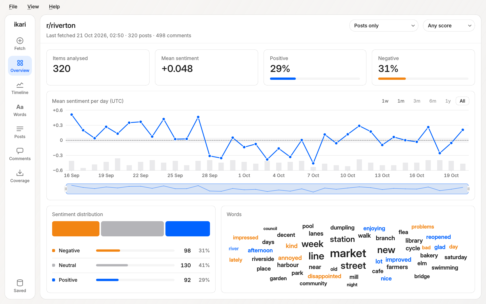
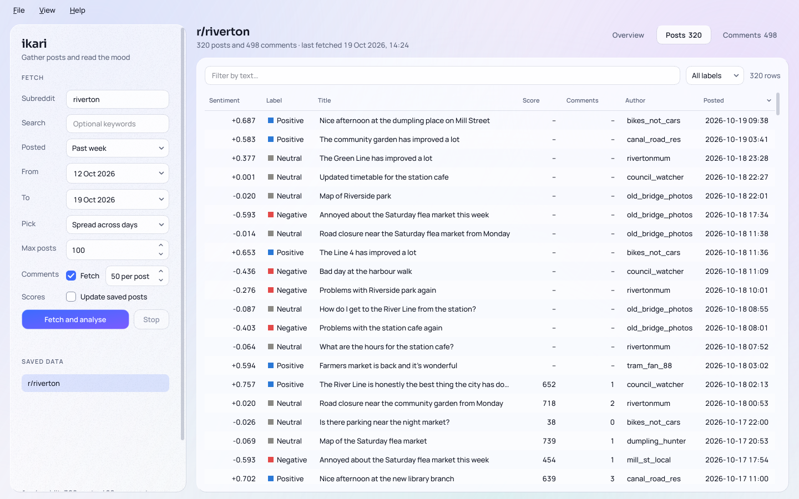
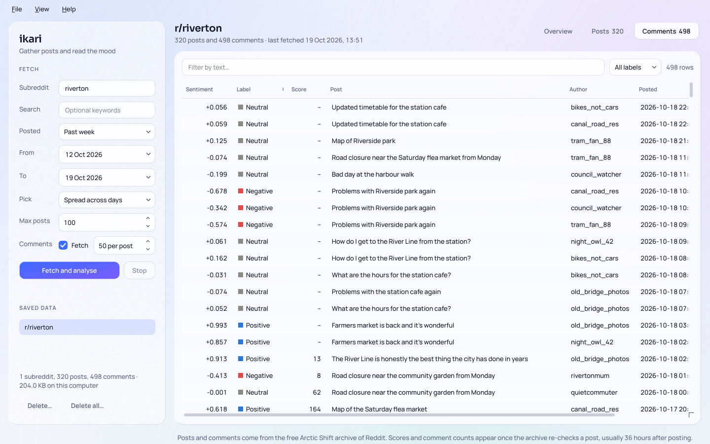
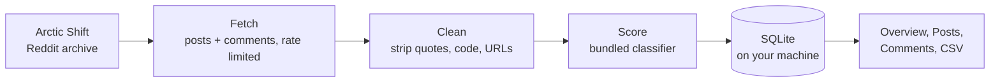

<div align="center">


<h1>ikari</h1>

<p><b>Read the mood of any subreddit.</b><br>
Pull posts and comments, score their sentiment offline, and explore the results in a desktop app
for Windows, macOS and Linux.</p>

<p>
  <a href="https://github.com/nekomancer01/ikari/releases"></a>
  <a href="https://github.com/nekomancer01/ikari/actions/workflows/build.yml"></a>
  
  
  
</p>

<p>
  <a href="https://github.com/nekomancer01/ikari/releases/latest"></a>
</p>

<p>
  <a href="#features">Features</a> ·
  <a href="#how-it-works">How it works</a> ·
  <a href="#download">Download</a> ·
  <a href="#run-from-source">Run from source</a> ·
  <a href="#where-the-data-comes-from">Where the data comes from</a> ·
  <a href="#development">Development</a>
</p>

<br>

<picture>
  <source media="(prefers-color-scheme: dark)" srcset="docs/overview-dark.png">
  
</picture>

</div>

<table>
  <tr>
    <td width="50%" valign="top">
      <picture>
        <source media="(prefers-color-scheme: dark)" srcset="docs/posts-dark.png">
        
      </picture>
      <p align="center"><sub><b>Posts</b>: sort, filter by text or label, double-click to open on Reddit</sub></p>
    </td>
    <td width="50%" valign="top">
      <picture>
        <source media="(prefers-color-scheme: dark)" srcset="docs/comments-dark.png">
        
      </picture>
      <p align="center"><sub><b>Comments</b>: every reply, scored, with the post it belongs to</sub></p>
    </td>
  </tr>
</table>

<p align="center"><sub>Screenshots follow your GitHub theme. They show invented sample data for a made-up city,
r/riverton, whose new tram line breaks down for a week. Regenerate them with
<code>QT_QPA_PLATFORM=offscreen python tools/screenshot.py</code>.</sub></p>

## Features

- 📥 **Fetch** any subreddit for a date range (a preset like "Past week", or your own From and To
  dates), optionally narrowed by keywords. Comments come along by default. No Reddit account or API
  key is needed.
- 🧠 **Score sentiment offline** with a small bundled classifier (TF-IDF plus
  [VADER](https://github.com/cjhutto/vaderSentiment) features) trained on GoEmotions Reddit
  comments. Nothing leaves your machine for scoring.
- 📊 **See the overview**: summary tiles, the sentiment split, mean sentiment per day, and the
  most positive and negative items.
- 🔎 **Browse posts and comments** in sortable, filterable tables. Double-click a row to open it
  on Reddit.
- 💾 **Keep your data** in a local SQLite database. Fetching again updates existing rows, and
  File → Export writes CSV.
- 🌗 **Pick a theme**: the glass interface comes in light and dark (View menu, or follow the
  system). **Reduce transparency** makes every panel opaque.
- 🔄 **Stay up to date**: Help → Check for updates… finds a newer release on GitHub, downloads it
  and hands off to the installer. It also checks at startup, which you can turn off.

### How accurate is it?

The classifier is tuned for accurate totals over many comments rather than every single one.
On the GoEmotions test split:

| | Labels right | Error in the overall positive / neutral / negative split |
|---|:-:|:-:|
| **ikari's model** | **73%** | **4 points** |
| Plain VADER | 65% | 14 points |

Quoted text, code blocks and URLs are stripped before scoring. Plain VADER is the fallback if the
model is missing. Obvious sarcasm (a trailing `/s`, 🙄, or "gotta love…" wrapped around
something bad) flips a positive score to negative; subtler sarcasm is scored literally.
Reproduce the numbers with `tools/eval_sentiment.py` (add `--sarcasm` for the sarcasm slice).

## How it works



## Download

Ready-made builds for Windows, macOS and Linux are attached to each
[release](https://github.com/nekomancer01/ikari/releases). Builds of the latest `main` are on the
[Actions tab](https://github.com/nekomancer01/ikari/actions/workflows/build.yml) (open a run, then
*Artifacts*).

| OS | Download | How to run |
|---|---|---|
| Windows 10/11 (x64) | `ikari-Setup-<version>.exe` | Run the installer. Or unzip `ikari-<version>-windows-x64.zip` and run `ikari.exe`. |
| macOS 11+ (Apple Silicon) | `ikari-<version>-macos-arm64.dmg` | Open the .dmg and drag the app to Applications. |
| macOS 11+ (Intel) | `ikari-<version>-macos-x86_64.dmg` | As above. |
| Linux (x86_64) | `ikari-<version>-linux-x86_64.AppImage` | `chmod +x` it, then run it. Or unpack the `.tar.gz` and run `./install.sh` to add it to your app menu (`./install.sh --uninstall` removes it). |

> [!NOTE]
> The builds aren't code-signed, so the first launch shows a warning.
>
> - **Windows** SmartScreen ("Windows protected your PC"): choose **More info → Run anyway**.
> - **macOS** Gatekeeper ("can't be opened because Apple cannot check it"): right-click the app,
>   choose **Open**, then **Open** again. On macOS 15, if there's no Open button, go to
>   **System Settings → Privacy & Security** and click **Open Anyway**.
> - **Linux**: the AppImage needs FUSE 2 (`sudo apt install libfuse2` on Ubuntu 22.04,
>   `libfuse2t64` on 24.04), or run it with `--appimage-extract-and-run`. Qt also needs
>   `libxcb-cursor0` on X11, which some minimal installs lack.

## Run from source

Install Python 3.10 or newer, then:

- **Windows:** double-click `run-windows.bat` (tick *Add python.exe to PATH* when installing
  Python from [python.org](https://www.python.org/downloads/)).
- **macOS:** double-click `run-macos.command`, or run `./run.sh` in Terminal.
- **Linux:** run `./run.sh`.

The first run sets up a private environment in `.venv` (about a minute); after that it opens
straight away. Delete `.venv` to reinstall.

## Build the app yourself

<details>
<summary>Build commands and what ends up in <code>dist/</code></summary>

Builds are made on the OS they're for. In a Python environment:

```bash
pip install . pyinstaller
python packaging/build.py        # Linux: add --no-appimage to skip the AppImage
```

On Windows you can instead double-click `packaging\build-windows.bat`. Everything lands in
`dist/`: the zip and installer on Windows (the installer needs
[Inno Setup 6](https://jrsoftware.org/isinfo.php)), the `.app` and `.dmg` on macOS, and the
AppImage and `.tar.gz` on Linux.

The workflow in `.github/workflows/build.yml` builds and launch-checks all four targets on every
push to `main` and every pull request. Pushing a `v*` tag also publishes a GitHub release with
the packages attached. The version comes from `__version__` in `src/subsentiment/__init__.py`.

</details>

## Platform features

<details>
<summary>What ikari does differently on each OS, and where it keeps its data</summary>

- **macOS:** About and Quit sit in the app menu, with the standard ⌘Q shortcut.
- **macOS:** the title bar's light or dark look follows the app's theme. Optional "macOS vibrancy"
  background (View → Window background) gives a real frosted blur; off by default, applies on next
  launch.
- **Linux:** registers as `io.github.nekomancer01.ikari`, so docks and Wayland
  compositors show the right icon and name.
- **Linux:** "Match system theme" also works on desktops that don't report dark mode to Qt, by
  reading the GNOME/GTK setting.
- **Windows:** title bar matches the theme; optional Mica or Acrylic background on Windows 11
  22H2+; taskbar shows the app's own icon.

Data lives in the OS's app-data folder: `%APPDATA%\subsentiment\Subreddit Sentiment\` on
Windows, `~/Library/Application Support/subsentiment/Subreddit Sentiment/` on macOS, and
`~/.local/share/subsentiment/Subreddit Sentiment/` on Linux. The folder keeps the
app's former name so existing data carries over.

</details>

## Where the data comes from

Posts and comments come from [Arctic Shift](https://github.com/ArthurHeitmann/arctic_shift), a free,
community-run archive of Reddit. It needs no account or key. ikari doesn't use Reddit's own API:
Reddit stopped serving its public JSON to logged-out requests in 2026, now requires approval for
new API apps, and has announced that its public API closes in March 2027.

Things to know about the archive:

- **You pick a date range, and posts are spread across it.** Choose a preset under **Posted** or set
  your own **From** and **To** dates. The range is cut into equal parts (up to four a day) and
  **Max posts** is shared equally between them, so a week with 70 posts gives about 10 a day instead
  of the 70 newest. Quiet parts hand their share to busier ones. Fetching the same range again adds
  posts you don't have yet, rather than the same ones.
- **Top posts are ranked by ikari, not the archive.** The archive can only search by date. With
  **Pick** set to **Top by score**, ikari reads a pool of posts from each day of the range and keeps
  the highest-scored. Only posts the archive has re-checked have scores (see below), so the newest
  posts can't be ranked and come after scored ones.
- **Scores and comment counts arrive late.** The archive saves each post within seconds, then fetches
  it again later, usually about 36 hours after posting and sometimes up to a week. Until then
  Reddit's numbers aren't known, so the Score and Comments columns show a dash. The next fetch of that
  range fills them in if **Scores: Update saved posts** is ticked; it re-checks those posts in batches
  of 500. It's off by default because it adds requests to every fetch.
- **Requests are rate limited and shared.** Every request in a fetch (posts, score updates and
  comments) goes through one limiter, at most about two and a half a second (the archive's docs say "a few
  requests per second is fine"). When the archive says to slow down
  (HTTP 429) ikari waits as long as it asks and spaces later requests further apart; it also backs
  off on server and network errors. When a query times out ("Timeout. Maybe slow down a bit"), it
  waits, asks for a smaller page, then searches a narrower slice of time. The status line says when
  it's waiting and why.
- **Comments take one request per post.** ikari asks for each post's whole comment tree at once and
  keeps the highest-scored. If a post's comments can't be fetched, it moves on to the next; after
  five failures in a row it stops asking, and the next fetch of the range picks up the posts that
  are still missing comments. 100 posts with comments take about a minute.
- **It's a volunteer service** with no uptime guarantee. Items that were removed or deleted on Reddit
  are skipped.

Upgrading from a version that used Reddit API keys? ikari clears the saved client id and secret from
its settings on start. A copy may remain in your system's credential store (Windows Credential
Manager, macOS Keychain or Secret Service) under "Subreddit Sentiment", and you can delete it there.

## Design notes

<details>
<summary>Type, glass and chart colors</summary>

- Type: [Manrope](https://fonts.google.com/specimen/Manrope) for the interface and
  [Sora](https://fonts.google.com/specimen/Sora) for headings and big numbers. Tabular figures are
  on so numbers line up. Qt's variable-font weight matching is unreliable, so the fonts are bundled
  as static weights in `src/subsentiment/gui/assets/`.
- Glass is used for the sidebar, stat tiles and chart cards. Tables and lists sit on near-solid
  panels so dense text stays readable, and glass is never stacked on glass.
- Chart colors: blue for positive, red for negative, gray for neutral, checked for color-blind
  separation. Bars are always labelled, so color is never the only cue.

### Licenses

- Manrope and Sora are licensed under the [SIL Open Font License 1.1](https://openfontlicense.org/).
  Their license texts ship with the app as `src/subsentiment/gui/assets/Manrope-OFL.txt` and
  `src/subsentiment/gui/assets/Sora-OFL.txt`.

</details>

## Development

```bash
.venv/bin/pytest
```

Layout:

| Path | Purpose |
|---|---|
| `src/subsentiment/arctic_shift.py` | Arctic Shift client: even and top sampling, batch refresh, comment trees, rate limiter |
| `src/subsentiment/reddit.py` | Post and comment data types, subreddit-name checks |
| `src/subsentiment/sentiment.py` | Text cleanup + scoring (bundled model, VADER fallback) |
| `src/subsentiment/sentiment_model.py` | Loads the bundled classifier and its feature code |
| `src/subsentiment/store.py` | SQLite storage, CSV export, summary helpers |
| `src/subsentiment/updater.py` | Looks up the latest GitHub release and downloads it |
| `tools/train_model.py` | Trains the bundled sentiment classifier on GoEmotions |
| `tools/eval_sentiment.py` | Scores accuracy against GoEmotions (the numbers in Features) |
| `tools/screenshot.py` | Renders the README screenshots in `docs/` from invented sample data |
| `tools/sample_text.py` | The invented r/riverton posts and comments the screenshots use |
| `src/subsentiment/collect.py` | One fetch job: refresh saved scores, pick new posts, fetch comments, score, store |
| `src/subsentiment/gui/` | Qt main window, charts, table models, background worker |
| `src/subsentiment/gui/theme.py` | Glass theme: color tokens, stylesheet, fonts, backdrop |
| `src/subsentiment/gui/native/` | Per-OS integration: Windows title bar and Mica/Acrylic, macOS menus and vibrancy, Linux desktop id and theme |
| `packaging/build.py` | One build entry for all platforms (PyInstaller, then zip/installer, .dmg, or AppImage/.tar.gz) |
| `packaging/` | PyInstaller spec, Inno Setup installer, Linux AppRun/.desktop/install.sh |
| `tools/live_check.py` | Fetches a small sample from the real archive and prints what came back |
| `tools/make_icon.py` | Regenerates the app icons (needs Pillow) |
